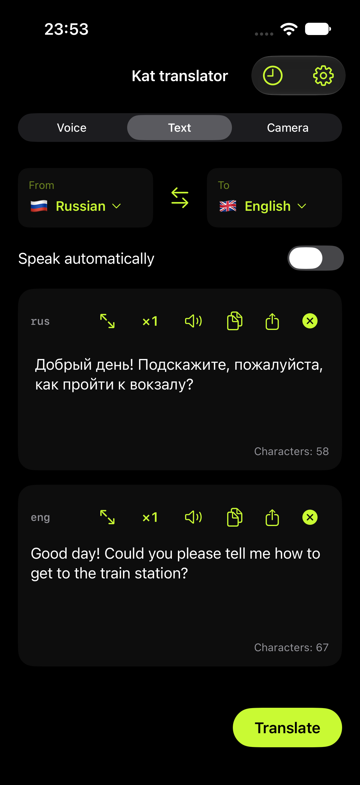
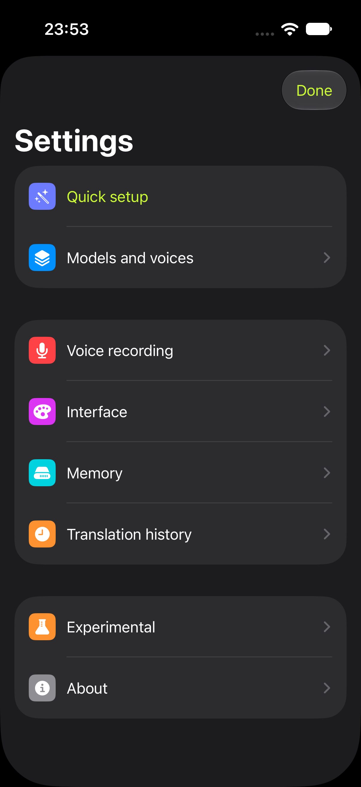
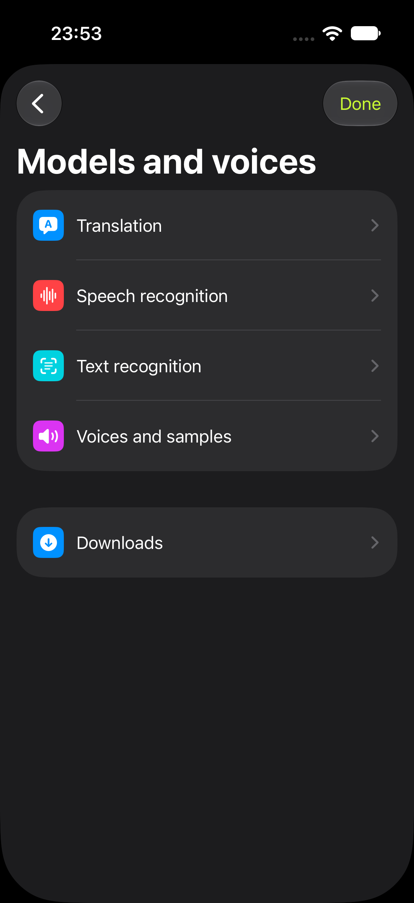

# Kat translator

**English** | [Русский](README.ru.md)

Offline AI translation for **iPhone, Apple Silicon Mac and ARM64 Android**. Translate speech, text and words in images using models on your device. Download the required models and voices before going offline.

[App Store](https://apps.apple.com/app/kat-translator/id6822496243) · [Website](https://etcusr.github.io/kat-translator/) · [Current versions](docs/CURRENT_STATE.md) · [Documentation](docs/README.md)

Apple settings bring models, voices and **Quick setup** together. Choose languages, install the packages you need and manage downloads in one place. Voice recording shows microphone activity behind the record button; original recordings and translated speech can be played and shared separately.

**Next release:** 1.1.0 is being prepared locally. New screenshots, release notes and validation status are tracked in the [release package](docs/publication/2026-10-22/README.md). This is not an upload or publication announcement. The experimental phrase-by-phrase voice mode is optional and may miss or change words.

**Privacy:** processing and history stay on your device; model downloads require an internet connection. Recognition, translation and speech availability depend on the language, model and hardware. Check important numbers, names and conditions against the original.

**GPL-3.0-or-later.** [License](LICENSE) · [Third-party licenses](docs/LICENSING.md) · [Repository privacy](docs/REPOSITORY_PRIVACY.md).

## Interface preview

Upcoming Apple update; iPhone simulator captures. [All languages and capture details](docs/publication/2026-10-22/README.md).

<p>
<a href="site/assets/screenshots/2026-10-22/ios/en/01-text.png"></a>
<a href="site/assets/screenshots/2026-10-22/ios/en/03-settings.png"></a>
<a href="site/assets/screenshots/2026-10-22/ios/en/04-models-and-voices.png"></a>
</p>

## Features

- Voice input, audio import, text translation, phone cameras and images on Mac.
- Local ASR → MT → TTS, model and voice selection, package downloads and verification.
- Language lists, search and favorites, with separate state for each working mode.
- History of text, original recordings, synthesized speech and images, depending on settings.
- Original and translated audio playback, pause/speed controls, copying and system sharing.
- Russian, English, Spanish and Turkish interfaces. Mac also supports keyboard shortcuts and translation of selected text, clipboard contents and screen regions.

The main voice workflow processes a recording after it stops. Recognition previews do not imply verified simultaneous conversation translation. Speed, quality and features are not guaranteed to be identical across all three platforms.

The experimental Apple phrase-preview path uses speech pauses, timestamped sentence boundaries and LocalAgreement with retained audio context. Published phrases are not replaced; only the unpublished tail is completed after stop when full verification is off. Early results can still differ from whole-recording recognition and translation. See the [algorithm, research and device quality checks](docs/publication/voice-streaming-quality-2026-10-22.md).

## Models and platform differences

| Stage | iPhone | Mac, modern release | Android |
|---|---|---|---|
| Index-Translate 9B | llama.cpp / Metal, Q4_K_M, MTP2 | MLX 4bit + MTP2 | llama.cpp / Vulkan, Q4_K_M, MTP; Mali-G715 profile |
| Index-Translate 2B | llama.cpp / Metal, Q4_K_M | separate llama.cpp / Metal, Q4_K_M | llama.cpp / Vulkan, Q4_K_M, no MTP |
| OPUS Big, EN↔RU/UK/BE | CTranslate2 CPU INT8 | separate Python / PyTorch Metal FP16 worker, beam5 | CTranslate2 CPU INT8 |
| OPUS directions from the catalog | CTranslate2 CPU INT8 | CTranslate2 CPU INT8 | CTranslate2 CPU INT8 |
| Auto ASR | Whisper Q8 / Metal; Meta for additional languages | Whisper F16 / Metal; Meta for additional languages | RU → GigaAM v3; EN → Parakeet TDT v2; other supported languages → Whisper Q8 |
| OCR | Apple Vision + local OCR routing | Apple Vision + local OCR routing | bundled ML Kit for supported scripts; PP-OCR for Russian |
| Initial MT selection | Auto | Auto | Auto |

On iOS, initial language setup recommends Whisper large-v3-turbo Q8 (874.2 MB) for Whisper-supported languages. Existing installations download this new asset once; old F16 files, other models, settings and history are retained. With technical information enabled, Voice exposes **Open audio file** for diagnostic recognition/translation using the existing automatic-speech switch. The native Whisper runtime uses Metal without Core ML.

Updates preserve the saved model selection. Auto chooses an installed model for the language pair based on the device test: 9B, then 2B on powerful devices; supported OPUS, then 2B and 9B on others. The older OPUS EN package translates **EN↔RU/UK/BE**; the direction catalog adds direct pairs, including pairs without English. There is no hidden pivot translation. Of 54 direction packages, 10 are available for download and 44 require manual installation until hosting is available. Index has broad text-language coverage; this does not establish quality for every pair or equivalent ASR/TTS/OCR coverage. Model and license sources: [assets/catalogs](assets/catalogs), [publication package inventory](docs/publication/2026-10-12/evidence/model-inventory.csv).

Mac `macos15-26` is a separate retained release with Index MLX+MTP2 and the earlier CPU OPUS implementation. It has not received GPU OPUS, Index 2B, the new directions, Auto translation or later interface changes from the modern release. [Versions, operating systems and verification limits](docs/CURRENT_STATE.md).

Index uses a fixed 2048-token context window with up to 1536 input tokens; the response uses the remaining space. Budget estimation and splitting guard against overflow. Experimental context memory and window selection have been removed. OPUS has separate limits and splitting. [Preflight](docs/benchmarks/translation-preflight/README.md) · [OPUS](docs/IMPLEMENTATION-opus-big.md).

## Repository layout

| Path | Purpose |
|---|---|
| `apps/ios`, `apps/macos`, `apps/android` | Platform apps, projects and tests |
| `shared/apple` | Shared SwiftUI screens, AppModel and Apple adapters |
| `shared/packages/OfflineCore` | Swift data models, pipeline, storage, policies and tests |
| `shared/native` | C/C++ runtimes and Python workers |
| `assets/catalogs`, `assets/bundled` | Package catalogs and small shared resources |
| `model-store` | Shared local model cache, excluded from Git |
| `Dependencies` | Pinned versions, vendor sources and build dependencies |
| `scripts`, `tests`, `Tools` | Builds, diagnostics, shared fixtures and local import |
| `docs`, `.build`, `dist` | Documentation; local outputs; installers |

[Detailed layout](docs/android/PLATFORM_LAYOUT.md). The old `App/`, `Packages/` and `Native/` paths in earlier documents predate the migration. Source code is in Git; model weights, installers and local data are stored separately. Check the working tree and current versions before making changes.

## Build and validation

The build host is an Apple Silicon Mac with Xcode, CMake/Python and prepared pinned dependencies. These are not end-user requirements. Model weights and the complete environment are not included in Git. Run the commands below from the repository root; building does not install the app.

```sh
# Shared Swift policies
swift test --package-path shared/packages/OfflineCore --scratch-path .build/core
# Catalog consistency
python3 scripts/generate-model-catalog.py --check
# iPhone: native dependencies must already be prepared
python3 scripts/generate-project.py
xcodebuild -project apps/ios/OfflineTranslator.xcodeproj -scheme OfflineTranslator \
  -configuration Release -destination 'generic/platform=iOS' \
  -derivedDataPath .build/DerivedData CODE_SIGNING_ALLOWED=NO build
```

Apple dependency preparation: `scripts/build-whisper.sh`, `scripts/build-translation.sh`, `scripts/fetch-speech-runtime.py`, `scripts/prepare-speech-recognition.py`; additional runtimes depend on the selected configuration. Full platform instructions: [Mac](docs/macos/README.md), [Android](docs/android/INSTALL.md), [current status](docs/CURRENT_STATE.md).

Xcode generators define project membership. Local iOS signing settings live in `apps/ios/Config/Signing.local.xcconfig` (ignored). Since October 14, the iOS Bundle ID is `app.kattranslator`, with `app.kattranslator.downloads` for the extension. Build46 with the new ID is installed; models, history and settings have been migrated and verified. The old app is retained separately. [Results and limitations](docs/maintenance/ios-kat-migration-2026-10-14.md). Preserve bundle IDs, signing identity, models and data during ordinary updates. Build numbers increase independently; versions change during release preparation. After an iOS version change, the generator synchronizes the widget version.

Hardware tests are separate from unit tests and compilation. Do not run instrumentation alongside manual translation or another intensive experiment on the same device. [Current results and remaining checks](docs/CURRENT_STATE.md).

## Documentation

- [Documentation index](docs/README.md) — all living documents in English and Russian.
- [CURRENT_STATE](docs/CURRENT_STATE.md) — current versions, implemented changes, limitations and evidence.
- [Publication queue](docs/publication/OPEN_QUESTIONS.md) — what remains before App Store / Google Play publication.
- [Architecture](docs/ARCHITECTURE.md) — components, key files and builds.
- [Android](docs/android/README.md), [Mac](docs/macos/README.md), [iPhone testing](DEVICE_TESTING.md).
- [Publication preparation](docs/publication/2026-10-22/README.md) — dated preparation materials, not a published app.
- [Animations](docs/branding/loading-animations/README.md), [branding](docs/branding/README.md).
- [Previous README](docs/history/README-before-2026-10-12-sync.md) — archived details of earlier iterations.
