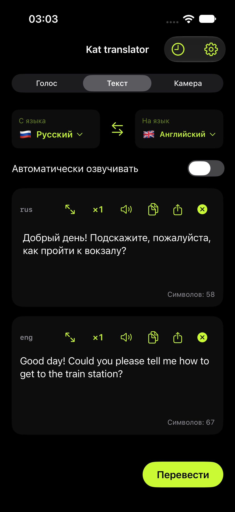
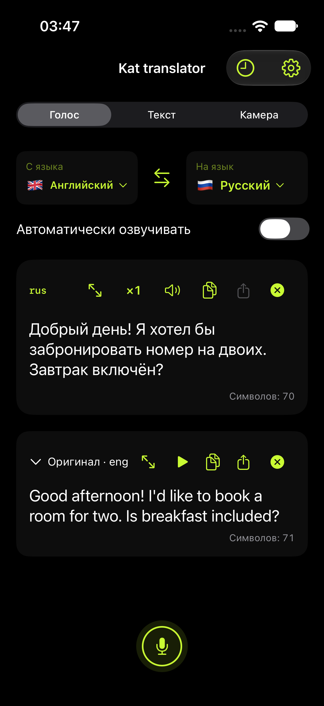
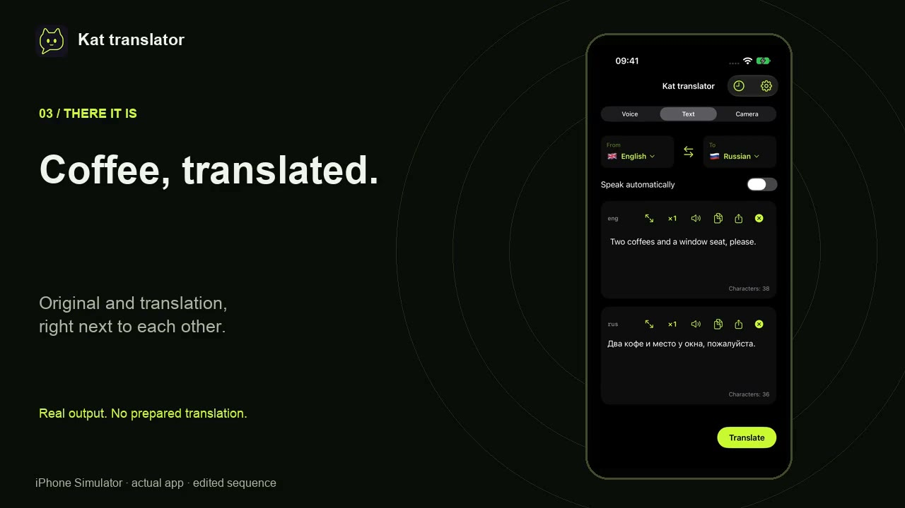

# Kat translator

[English](README.md) | **Русский**

Офлайн-переводчик с ИИ для **iPhone, Mac с Apple Silicon и ARM64 Android**. Переводит речь, текст и надписи на изображениях с помощью моделей на устройстве. Загрузите нужные модели и голоса заранее, чтобы пользоваться ими без интернета.

[App Store](https://apps.apple.com/app/kat-translator/id6822496243) · [Сайт](https://etcusr.github.io/kat-translator/) · [Текущие версии](docs/CURRENT_STATE.ru.md) · [Документация](docs/README.ru.md)

В настройках Apple модели, голоса и **«Быстрая настройка»** собраны вместе. Здесь можно выбрать языки, установить нужные пакеты и управлять загрузками. Во время записи за кнопкой отображается активность микрофона; оригинальную запись и озвученный перевод можно воспроизводить и отправлять отдельно.

**Следующий выпуск:** версия 1.1.0 готовится локально. Скриншоты, заметки о версии и результаты проверок собраны в [релизном пакете](docs/publication/2026-10-22/README.ru.md). Это не сообщение о загрузке или публикации. Экспериментальный пофразовый голосовой режим включается отдельно и может пропускать или изменять слова.

**Конфиденциальность:** обработка и история остаются на устройстве; для загрузки моделей нужен интернет. Доступность распознавания, перевода и озвучки зависит от языка, модели и устройства. Проверяйте важные числа, имена и условия по оригиналу.

**GPL-3.0-or-later.** [Лицензия](LICENSE) · [Сторонние лицензии](docs/LICENSING.ru.md) · [Приватность репозитория](docs/REPOSITORY_PRIVACY.md).

## Предпросмотр интерфейса

Готовящееся обновление Apple-версий; снимки симулятора iPhone. [Все языки и сведения о съёмке](docs/publication/2026-10-22/README.ru.md).

<p>
<a href="site/assets/screenshots/2026-10-22/ios/ru/01-text.png"></a>
<a href="site/assets/screenshots/2026-10-22/ios/ru/07-voice.png"></a>
</p>

В кадрах Голос использован подготовленный пример: это показ интерфейса, а не проверка моделей.

[](site/assets/video/kat-ios-demo.mp4)

[Ролик на 33 секунды](site/assets/video/kat-ios-demo.mp4): настоящий перевод и настройки в симуляторе iPhone, с анимированными титрами. Монтаж с ускорением 1,15× и фоновой музыкой; не тест скорости настоящего iPhone. [Подробности записи](docs/publication/ios-demo-2026-10-23.md).

## Возможности

- Голосовой ввод, импорт аудио, текстовый перевод, камера на телефонах и изображения на Mac.
- Локальные ASR → MT → TTS, выбор модели и голосов, загрузка и проверка пакетов.
- Языковые списки, поиск и избранное, отдельные состояния рабочих режимов.
- История текста, оригинальной записи, озвучки и изображений; сохранение зависит от настроек.
- Воспроизведение оригинала и перевода, пауза/скорость, копирование и системное меню отправки.
- Русский, английский, испанский и турецкий интерфейс. Mac дополнительно поддерживает горячие клавиши, перевод выделения/буфера/области экрана.

Основной завершённый голосовой сценарий обрабатывает запись после остановки. Наличие предварительного распознавания не означает подтверждённый синхронный перевод разговора. Нет обещания одинаковой скорости, качества или полного совпадения функций на трёх платформах.

Экспериментальная пофразовая обработка Apple использует речевые паузы, границы предложений с временными метками и LocalAgreement с сохранением аудиоконтекста. Опубликованные фразы не заменяются; при выключенной полной перепроверке после остановки завершается только неопубликованный хвост. Ранние результаты по-прежнему могут отличаться от распознавания и перевода всей записи. См. [алгоритм, исследование и проверки качества на устройстве](docs/publication/voice-streaming-quality-2026-10-22.md).

## Модели и различия платформ

| Этап | iPhone | Mac, современный выпуск | Android |
|---|---|---|---|
| Index-Translate 9B | llama.cpp / Metal, Q4_K_M, MTP2 | MLX 4bit + MTP2 | llama.cpp / Vulkan, Q4_K_M, MTP; профиль Mali-G715 |
| Index-Translate 2B | llama.cpp / Metal, Q4_K_M | отдельный llama.cpp / Metal, Q4_K_M | llama.cpp / Vulkan, Q4_K_M, без MTP |
| OPUS Big, EN↔RU/UK/BE | CTranslate2 CPU INT8 | отдельный Python / PyTorch Metal FP16 worker, beam5 | CTranslate2 CPU INT8 |
| OPUS-направления из каталога | CTranslate2 CPU INT8 | CTranslate2 CPU INT8 | CTranslate2 CPU INT8 |
| ASR «Авто» | Whisper Q8 / Metal; Meta для дополнительных языков | Whisper F16 / Metal; Meta для дополнительных языков | RU → GigaAM v3; EN → Parakeet TDT v2; остальные поддерживаемые языки → Whisper Q8 |
| OCR | Apple Vision + локальный OCR по маршрутизации | Apple Vision + локальный OCR по маршрутизации | bundled ML Kit для поддержанных письменностей; русский PP-OCR |
| Начальный выбор MT | Авто | Авто | Авто |

Сохранённый выбор модели при обновлении сохраняется. «Авто» выбирает установленную модель для пары с учётом теста устройства: на мощном — 9B, затем 2B; на остальных — поддержанный OPUS, затем 2B и 9B. Старый OPUS EN-пакет переводит **EN↔RU/UK/BE**; отдельный каталог направлений добавляет прямые пары, включая пары без EN. Скрытого перевода через промежуточный язык нет. Из 54 пакетов направлений 10 доступны для сетевой загрузки, 44 требуют ручной установки до появления хостинга. Index имеет широкий текстовый каталог; это не подтверждение качества каждого направления и не одинаковое покрытие ASR/TTS/OCR. Источники моделей и лицензий — [assets/catalogs](assets/catalogs), [реестр пакетов для публикации](docs/publication/2026-10-12/evidence/model-inventory.csv).

Mac `macos15-26` — отдельный сохранённый выпуск: Index MLX+MTP2, прежний OPUS CPU. Он не получил OPUS GPU, Index 2B, новые направления, режим «Авто» перевода и последующие правки интерфейса современного выпуска. [Версии, ОС и границы проверки](docs/CURRENT_STATE.ru.md).

Index: фиксированное окно 2048 токенов, вход до 1536; ответ использует оставшееся место. Предварительная оценка бюджета и разбиение защищают от переполнения. Экспериментальная память контекста и выбор окна удалены. OPUS имеет отдельные лимиты и разбиение. [Preflight](docs/benchmarks/translation-preflight/README.md) · [OPUS](docs/IMPLEMENTATION-opus-big.ru.md).

## Структура

| Путь | Назначение |
|---|---|
| `apps/ios`, `apps/macos`, `apps/android` | Платформенные приложения, проекты и тесты |
| `shared/apple` | Общие SwiftUI-экраны, AppModel, Apple-адаптеры |
| `shared/packages/OfflineCore` | Swift-модели данных, конвейер, хранение, политики и тесты |
| `shared/native` | C/C++ runtimes и Python workers |
| `assets/catalogs`, `assets/bundled` | Каталоги пакетов и общие небольшие ресурсы |
| `model-store` | Общий локальный кэш моделей, исключён из Git |
| `Dependencies` | Закреплённые версии, vendor sources и сборочные зависимости |
| `scripts`, `tests`, `Tools` | Сборка, диагностика, общие fixtures, локальный импорт |
| `docs`, `.build`, `dist` | Документация; локальные результаты; установщики |

[Подробная карта](docs/android/PLATFORM_LAYOUT.ru.md). Старые пути `App/`, `Packages/`, `Native/` в ранних документах предшествуют миграции. Исходники сохранены в Git; веса моделей, установщики и локальные данные хранятся отдельно. Перед работой проверяйте состояние дерева и актуальные версии.

## Сборка и проверка

Сборочная машина — Mac с Apple Silicon, Xcode, CMake/Python и подготовленными pinned dependencies. Это не требования к конечному пользователю. Весов моделей и полного окружения нет в Git. Команды ниже выполняются из корня; сборка не означает установку.

```sh
# Общие Swift-политики
swift test --package-path shared/packages/OfflineCore --scratch-path .build/core
# Согласованность каталога
python3 scripts/generate-model-catalog.py --check
# iPhone: с уже подготовленными native dependencies
python3 scripts/generate-project.py
xcodebuild -project apps/ios/OfflineTranslator.xcodeproj -scheme OfflineTranslator \
  -configuration Release -destination 'generic/platform=iOS' \
  -derivedDataPath .build/DerivedData CODE_SIGNING_ALLOWED=NO build
```

Подготовка Apple-зависимостей: `scripts/build-whisper.sh`, `scripts/build-translation.sh`, `scripts/fetch-speech-runtime.py`, `scripts/prepare-speech-recognition.py`; дополнительные runtime зависят от выбранного набора. Полные платформенные инструкции: [Mac](docs/macos/README.ru.md), [Android](docs/android/INSTALL.ru.md), [текущее состояние](docs/CURRENT_STATE.ru.md).

Генераторы Xcode — источник состава проектов. Локальная подпись iOS: `apps/ios/Config/Signing.local.xcconfig` (ignored). С 14.10 iOS Bundle ID — `app.kattranslator`, расширение — `app.kattranslator.downloads`. Build46 с новым ID установлен; модели, история и настройки перенесены и проверены. Старое приложение сохранено отдельно. [Результаты и ограничения](docs/maintenance/ios-kat-migration-2026-10-14.md). При обычных обновлениях сохраняйте bundle ID, идентичность подписи, модели и данные. Номера сборок увеличиваются независимо; версии меняются при подготовке выпуска. После изменения iOS-версии генератор синхронизирует widget.

Аппаратные тесты выполняются отдельно от unit tests и компиляции. Не запускать instrumentation одновременно с ручным переводом или другим тяжёлым опытом на том же устройстве. [Актуальные результаты и оставшиеся проверки](docs/CURRENT_STATE.ru.md).

## Документы

- [Указатель документации](docs/README.ru.md) — все живые документы на английском и русском.
- [CURRENT_STATE](docs/CURRENT_STATE.ru.md) — текущие версии, внедрённые изменения, ограничения и ссылки на доказательства.
- [Очередь публикации](docs/publication/OPEN_QUESTIONS.ru.md) — что осталось до публикации в App Store / Google Play.
- [Архитектура](docs/ARCHITECTURE.ru.md) — компоненты, ключевые файлы и сборка.
- [Android](docs/android/README.ru.md), [Mac](docs/macos/README.ru.md), [испытания на iPhone](DEVICE_TESTING.md).
- [Подготовка публикации](docs/publication/2026-10-22/README.ru.md) — датированный снимок материалов, не опубликованное приложение.
- [Анимации](docs/branding/loading-animations/README.ru.md), [брендинг](docs/branding/README.ru.md).
- [Предыдущий README](docs/history/README-before-2026-10-12-sync.md) — архив деталей ранних итераций.
